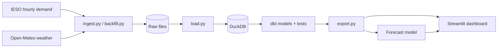

# Ontario Grid Pipeline


An automated data pipeline that collects Ontario's hourly electricity demand and Toronto's
weather, models it with dbt in DuckDB, tests data quality on every run, forecasts demand,
and publishes a live dashboard.

**Live dashboard:** https://electricity-grid-pipeline-z2wghoxgsy4vcisjqh7hcd.streamlit.app/

## Architecture



The whole pipeline runs daily in the cloud with GitHub Actions: it downloads new data,
runs every dbt test, retrains the forecast, and publishes refreshed data to the dashboard.
The same workflow runs on every push, so a failing test blocks broken code.

## Tech stack

Python, SQL, DuckDB, dbt, scikit-learn, Streamlit, GitHub Actions, Git

## Data

| Source | What | Frequency |
|---|---|---|
| [IESO](https://www.ieso.ca/power-data) | Ontario electricity demand (MW) | Hourly |
| [Open-Meteo](https://open-meteo.com) | Toronto air temperature | Hourly |

Coverage: January 2024 to today, about 24,000 hours.

## dbt models

| Model | Layer | Purpose |
|---|---|---|
| `stg_demand` | Staging | Converts IESO's Eastern Standard Time hours to UTC, removes duplicates |
| `stg_weather` | Staging | Drops missing readings, removes duplicates |
| `fct_hourly` | Mart | One row per hour: demand joined with temperature |

9 data tests run on every build: unique and non-null hours, plus realistic ranges for
demand (8,000 to 30,000 MW) and temperature (-40 to 45°C).

## Key findings

- **Heat drives demand more than cold.** Average demand is lowest at 10 to 15°C
  (about 14,300 MW), rises to about 19,300 MW in the coldest hours, and to about
  24,300 MW above 35°C, roughly 70% above the mild-weather level. A likely reason is that
  much of Ontario's heating uses natural gas, while air conditioning runs on electricity.
- **Daily pattern:** demand is lowest around 3 to 4 a.m. (about 14,000 MW) and peaks
  around 5 to 6 p.m. Eastern Standard Time (about 18,600 MW).
- **Weekends use less electricity,** mostly during working hours.
- **Seasonal pattern:** the highest daily peaks come in July each year, with smaller
  winter peaks and the lowest demand in spring and autumn.
- **Data quality:** the pipeline's checks found missing hours in IESO's published data
  for 1 May 2025.

## Demand forecast

A gradient-boosted model (scikit-learn) predicts hourly demand from hour of day, day of
week, month, temperature and demand at the same hour one week earlier.

| Method | Error (MAPE) on the last 90 days |
|---|---|
| Baseline: same hour last week | 7.53% |
| Model | **4.09%** |

The model cuts the forecast error by 46% compared with the baseline (results as of
October 2026; the model retrains daily, so the live dashboard shows the latest figures).
It was trained only on older data and tested on 90 days it never saw. The test uses
actual temperatures, so accuracy with a real weather forecast would be somewhat lower.

## Design decisions

- **Raw data is stored untouched,** so any transformation bug can be fixed by reprocessing,
  without downloading again.
- **Reruns are safe (idempotent):** files are overwritten by date and tables are rebuilt,
  so running twice never creates duplicates.
- **Time zones are aligned explicitly:** IESO reports "hour ending" in Eastern Standard Time
  all year, while the weather is in UTC. Getting this wrong would silently match every
  temperature to the wrong hour.
- **Left join for weather:** the weather archive runs a few days behind, so recent hours are
  kept with an empty temperature instead of being dropped.
- **Tests gate the dashboard:** if a dbt test fails, the pipeline stops before exporting,
  so bad data never reaches the charts.
- **Resilient downloads:** weather is fetched month by month with automatic retries and
  cached between runs, cutting the daily cloud run from about 14 minutes to under 1 minute.

## How to run

```bash
python -m venv .venv
.venv\Scripts\activate          # Windows (Mac/Linux: source .venv/bin/activate)
pip install -r requirements.txt

python backfill.py              # download history
python run_pipeline.py          # ingest, load, dbt build, export, forecast
streamlit run dashboard/app.py  # open the dashboard
```

## Next steps

- Holiday calendar, so public holidays are treated like weekends
- Compare the forecast with IESO's own published forecast